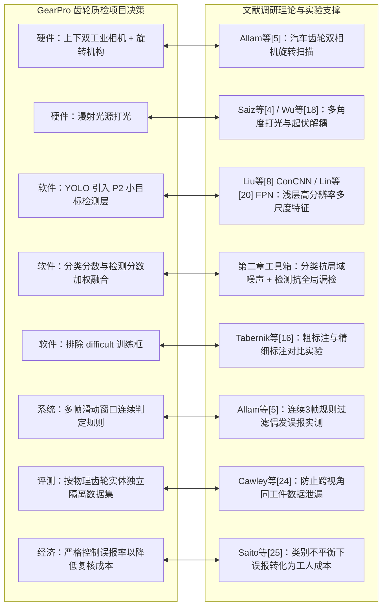

# 金属零件与齿轮外观缺陷视觉检测文献综述写作规范与指南

> **文档定位**：本文档系统总结了在机器视觉与齿轮质检项目中，撰写高质量、求真务实、符合大三工科学生认知视角的文献综述写作方法论。本文档融合了 `research-writing-skill` 核心准则、`文献综述-模板.doc` 结构范式以及 `GearPro_技术报告` 的实战经验。

---

## 一、 核心写作原则与作者身份定位

### 1. 作者身份与语调定位
- **作者身份**：大三工科本科生（机械/自动化/光电/计算机相关专业）。
- **语调风格**：**求真务实、谦逊朴素、注重工程实际、以调研笔记口吻展开**。
- **杜绝两类极端**：
  1. ❌ **杜绝 AI 假大空口吻**：不堆砌“赋能”、“关键工程攻坚”、“技术范式重构”、“高维流形坍缩”等夸张、浮夸、公文式词汇；
  2. ❌ **杜绝机械模板与免责套话**：不使用机械的“A 做了 B，指标为 C，这说明 D，但用于齿轮需 E”的填空式排比，也不在每段结尾生硬附带免责声明。

### 2. 学术求真与证据边界准则（对标 `research-writing-skill`）
- **数据与结论绑定**：不捏造任何未核实的文献作者、实验数据、准确率、FPS 或指标提升幅度；
- **分清事实与推断**：严格区分“文献作者原实验数据”、“本综述根据常理推断”与“对我们项目的建议性启发”；
- **不跨数据集拉踩**：不同文献在不同数据集、不同硬件上的指标不直接进行绝对高低对比，只在同篇文献的控制变量对照实验中分析收益。

---

## 二、 语言风格与用词禁忌对照表

在撰写正文时，应严格对照下表进行词汇和句式的去浮夸审查：

| 维度 | ❌ 禁用夸张/生硬词汇（脱离大三学生实际） |  推荐朴素工科用语（自然、求真） |
| :--- | :--- | :--- |
| **章节与小标题** | “关键工程攻坚”、“技术范式转向”、“核心分析主线” | **“关键问题与代表性文献研究”**、**“常见检测方法介绍”**、**“综述主要内容与范围”** |
| **背景阐述** | “是决定服役寿命的基础质量要素”、“将...纳入统一任务” | **“齿轮在运转中容易受划痕和缺损影响，产生噪音甚至损坏”**、**“视觉检测通常包括打光、拍照、处理和判断几个部分”** |
| **物理难点描述** | “底层光学感知”、“双向反射分布 BRDF 非均匀性”、“高频特征混叠” | **“金属表面强反光”**、**“切削磨削微观刀纹干扰”**、**“渐开线曲面与齿根阴影”** |
| **算法机制描述** | “特征自学习”、“拓扑流形嵌入”、“马氏距离度量偏离” | **“神经网络自动从图片中学习特征”**、**“对比测试图片与正常模式的差异找异常”** |
| **文献引述口吻** | “研究人员展开攻关”、“深刻揭示了工程规律” | **“Saiz等[4]为了解决反光问题，设计了……”**、**“实验结果表明……”**、**“从他们的实验中可以看出……”** |
| **项目启发表达** | “前置保障”、“优势互补”、“恪守独立评测协议” | **“先把光打好、把照片拍全”**、**“结合分类与检测两者的优点”**、**“测试时必须用没见过的新齿轮”** |

---

## 三、 篇幅规划与标准四章结构模板（5000字规格）

全文总字数严格控制在 **4800 ~ 5200 汉字** 之间，严格复刻 `文献综述-模板.doc` 的经典工科综述结构：

```
基于机器视觉的金属齿轮外观缺陷检测技术综述 (~5000字)
├── 题目、摘要与关键词 (~200字)
├── 一、 齿轮外观缺陷检测的研究背景 (~800字)
│   ├── 1. 齿轮质检的意义与人工目检的问题 (噪音磨损危害、疲劳与主观漏检)
│   ├── 2. 齿轮视觉检测遇到的实际困难 (金属反光、加工刀纹、曲面阴影、旋转多角度)
│   └── 3. 本文综述的主要内容与范围 (制造外观质检主线，界定不含探伤与振动寿命诊断)
├── 二、 常见的表面缺陷检测方法介绍 (~900字)
│   ├── 1. 传统的图像处理与人工特征方法 (LBP/SIFT+分类器，简单快速但怕光照变化)
│   ├── 2. 深度学习监督检测方法 (分类/目标检测/语义分割机制、输出形式与标注成本)
│   └── 3. 无监督异常检测方法 (正常样本建模、MVTec基准，解决小样本与开集痛点)
├── 三、 齿轮外观检测的关键问题与代表性文献研究 (~2300字，核心精读)
│   ├── 1. 解决金属表面反光与加工纹理的研究 (Saiz光度立体[4]、Wu多光源数据集[18])
│   ├── 2. 检测微小划痕与多尺度缺陷的研究 (Liu ConCNN[8]、Lin FPN[20]、Su MSFE-YOLO[19])
│   ├── 3. 旋转多角度拍摄与齿轮整件判定的研究 (Allam汽车齿轮双相机实测与连续帧规则[5])
│   └── 4. 缺陷样本少与标注困难的解决方法 (Tabernik换向器粗细标注[16]、Božič混合监督[22])
└── 四、 结论与对 GearPro 齿轮质检项目的启发 (~800字)
    ├── 1. 几种检测方法的对比与总结 (表1四类方法综合对比)
    └── 2. 对我们做 GearPro 齿轮检测项目的启发 (打光硬件、模型融合、多帧判定、误报控制)
```

---

## 四、 文献精读的撰写范式（像读书笔记一样呈现）

在第三章精读具体文献时，完全模仿 `文献综述-模板.doc` 的叙述习惯，每篇文献清晰交代**“研究动机 ➔ 实验装置与方法 ➔ 具体实测数据对比 ➔ 得出的结论与工程启示”**：

### 写作示范模板：
> **“学者等[文献号]针对 [具体问题] 进行了研究。为了解决该问题，他们搭建了 [具体装置/模型]，开展了 [具体实验]。*  
> *其实验对比结果表明：在 [某数据集/测试集] 上，采用 [某方法] 相比于 [基线方法]，指标从 [数据 A] 提升至 [数据 B]（或：产生了某项具体代价）。*  
> *这说明：[通俗解释该方法生效的物理/算法机理]。这项研究给我们的启发在于：[结合我们齿轮质检工程实际点出经验]。”**

---

## 五、 项目实际（GearPro）与文献精读的深度映射矩阵

文献综述不是泛泛而谈，必须为我们自己项目的每一次软硬件选型提供坚实的理论支撑：



---

## 六、 终稿自检清单（Self-Inspection Checklist）

在交付或定稿前，必须逐项执行以下六步自检：

- [ ] **1. 字数精确校验**：运行 Python 脚本统计正文纯汉字字符数，确认严格处于 `4800 ~ 5200` 范围内；
- [ ] **2. 语调去官话自审**：全文搜索并剔除“攻坚”、“范式”、“自学习”、“前置保障”等大词，确保通篇为大三学生求真务实的工科语气；
- [ ] **3. 结构单向流动自审**：确认第二章已完整介绍分类/检测/分割/异常检测原理，第三章纯粹按工程问题展开，两章无重复套娃；
- [ ] **4. 实验数据真实性核对**：核对文中出现的每一个百分比、FPS、工件数量（如 ConCNN 98.89%、Allam 34/100 误报、Tabernik 50 个工件等），确保与真实论文一致；
- [ ] **5. 项目联系紧密度检查**：检查第四章总结是否自然呼应了 GearPro 项目的打光、P2层、双相机、多帧判定与独立评测；
- [ ] **6. 参考文献规范性检查**：确认正文中 [1]~[22] 引用序号按首次出现顺序严格排列，无断号与错号。
