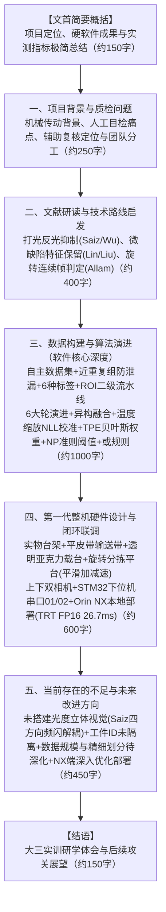

# 《GearPro 齿轮外观缺陷检测系统：项目进展情况小结》全新重构大纲

- **文档属性**：大三工科学生阶段性实训/科研项目进展小结（非正式发表论文，**无关键词、无参考文献列表**，文首设置**简明项目概况总结**）
- **目标字数**：2000 - 3000 字（篇幅精炼、结构紧凑、信息密度高）
- **核心参考依据**：
  1. 最终技术报告：《GearPro 技术报告》（`reports/GearPro_技术报告/Final/GearPro_技术报告.pdf` 及其源码 `GearPro_技术报告.md`、`reports/stage-report/`）
  2. 文献与技术依据：《基于机器视觉的金属齿轮外观缺陷检测技术综述》（`reports/GearPro_技术报告/项目总结与综述材料/01_基于机器视觉的金属齿轮外观缺陷检测技术综述_5000字.md`）
  3. 语言风格对准：《文献综述-模板.doc》（东南大学工科本科生优秀实训报告，严谨求真、平实自然、体现自主查阅文献与动手试错历程，**严禁“关键工程攻坚”、“突破性重大攻关”、“颠覆性创新”等夸大词汇**）

---

## 全新重构大纲架构

---

## 各章节详细内容规划

### 【文首】项目阶段进展简要概括（约 150 字）
*（按小结要求设置，开门见山，不做论文式摘要，不设关键词与英文）*
- 简明概括项目面向齿轮外观质检的定位（辅助人工复核的在线筛查原型）；
- 极简概述软硬件成果：自主采集 50 个真实齿轮，搭建“近重复组”防泄漏数据集与 6 种标签体系；历经 6 轮算法演进，确定 ROI 二级级联流水线、多模型异构融合、温度缩放概率校准、TPE 贝叶斯权重优化、经验奈曼–皮尔逊阈值与决策级“或规则”；在 150 张离线测试集上达 88.73% 召回率、22.78% 误报率；
- 硬件搭建第一代实物整机（上下双工业相机、白色漫射光、透明亚克力载台、步进电机平滑加减速旋转分拣平台、STM32 串口协议 01/02 及 Jetson Orin NX 本地推理），初步打通物理闭环。

---

### 一、 项目背景与实际质检问题（约 250 字）
1. **齿轮质检实际背景**：齿轮在动力传动中的核心地位；加工、热处理与流转中极易产生微细划痕与局部齿部碰伤缺损。
2. **车间人工目检痛点**：传统手持放大镜肉眼目检劳动强度大、工人易视觉疲劳产生漏检、检验员判断标准主观不一。
3. **系统定位与团队分工**：
   - 明确系统定位为“辅助人工复核的在线筛查工具”，非终检安全定性；
   - 大三团队分工（本人负责数据、算法、多模型融合与上位机软件；队员分别负责机械打光台架与 STM32 底层电控）。

---

### 二、 文献研读与技术路线启发（约 400 字）
*（严格模仿东南大学文献综述模板句式，体现自主研读文献、寻找技术依据的研学过程）*
1. **高反光金属打光启发**：阅读 Saiz 等、Wu 等文献，了解到金属镜面反射亮斑与阴影是微缺陷被淹没的物理主因，启发台架选用白色漫射光源配合导光罩与上下双相机布局；
2. **微细划痕特征保留启发**：阅读 Lin 等 (FPN)、Liu 等 (ConCNN) 等多尺度特征文献，认识到卷积网络深层下采样极易丢失细小空间细节，启发我们在 YOLO 中引入保留浅层特征的 P2 检测层；
3. **旋转多角度判定启发**：阅读 Allam 等关于汽车齿轮视觉质检文献，认识到旋转多视角拍摄是覆盖全齿面的物理基础，且单帧判断易受偶然反光误报，判定规则需结合连续多帧时序去重。

---

### 三、 数据构建、算法演进与决策依据（约 1000 字 · 软件核心重点）
*（全面落实用户要求的全部 11 项软件细节，层层递进，体现高含金量）*

1. **自主设计数据集、防泄漏划分与标签体系**：
   - **50 个真实齿轮自主建库**：采购与定制 50 个真实齿轮（正常 10、划痕 15、侧面缺损 15、齿角缺损 10），使用 2560×1440 相机多角度摆拍建库；
   - **逐渐严谨的 6 种标签体系**：演进确立了 6 类标签定义——`normal`（正常外观）、`scratch`（微细划痕）、三种细分缺齿位置标签（`bottom` 齿根碰伤、`oblique` 齿面斜向崩缺、`side` 齿侧剥落），以及 `difficult=1`（人眼极限模糊目标，训练集剔除以防梯度震荡）；
   - **防止数据泄漏的“近重复组”验证集划分（核心重要）**：利用 64 位感知哈希（dHash 汉明距离 ≤2）、文件序号邻近及宽高比推断视角（face, oblique, side）聚类构建近重复组；采用分层抽样平衡类别与视角分布，以“近重复组”为单位整体划分 train/val/test，最大组保留在训练集，划分后重新交叉验证跨集 dHash 距离，严格杜绝同一工件高度相似照片跨集泄漏。

2. **ROI 提取与二级级联检测流水线**：
   - 确立“先定位齿轮裁剪感兴趣区域（ROI 外扩 4%），再进行缺陷识别”的二级级联流水线，消除整帧杂乱背景对缺陷特征的干扰。

3. **六大轮算法实验演进历程**：
   - *第1轮（传统图像处理失败）*：Canny 与自适应阈值分割受金属反光亮斑及齿形伪边缘干扰完全失效；
   - *第2轮（整图端到端检测失败）*：无 ROI 约束直接在原图训练通用 YOLO，微细划痕与正常车削刀纹高度混淆，漏检极高；
   - *第3轮（引入 ROI 二级流水线）*：对比图像分类（整图粗判）与目标检测（框级定位）的任务与指标差异；
   - *第4轮（统一缺陷大模型受挫反思）*：两类缺陷合并训练统一分类模型，微细划痕漏检依旧，盲目增加融合模型徒增计算量；
   - *第5轮（分缺陷分别建模）*：划痕（线状弱对比）与齿部缺损（块状几何破坏）特征差异巨大，确立分别建模独立选型；
   - *第6轮（最终确定决策级融合与或规则）*：划痕子系统与缺损子系统独立输出判定，最终在决策层采用“逻辑或规则（OR Rule）”合并报警——任一子系统判定疑似缺陷即输出报警，实现分项专精、联合兜底。

4. **异构模型融合、概率校准与核心参数优化机制（高含金量技术核心）**：
   - **多模型异构融合架构**：采用“全局 CNN 分类（提取全图语义与抗噪粗判） + 局部目标检测（P2-YOLO 提取局部坐标框置信度）”异构互补结构；
   - **温度缩放（Temperature Scaling）概率校准（核心重点）**：针对不同异构模型输出的 logit/置信度尺度不一问题，在融合前通过验证集网格搜索最小化**负对数似然（NLL）**，为每个模型独立学习温度参数 $T$（如划痕三成员 $T$ 分别为 0.700、2.050、2.125；缺损三成员 $T$ 分别为 1.000、2.375、1.850），通过 $p_T = \sigma(\text{logit}(p)/T)$ 将各异构模型分数精确对齐到可比概率尺度；
   - **TPE 贝叶斯优化确定集成权重（核心重点）**：在加权融合公式中，利用基于树状 Parzen 估计器（TPE）的贝叶斯优化算法在验证集上全局寻优，为划痕子系统确定检测模型高权重 0.75、两分类模型各 0.125（强化微细划痕定位线索），为缺损子系统确定均衡权重（检测 0.50、两分类各 0.25）；
   - **经验奈曼–皮尔逊准则（Empirical NP Rule）确定判定阈值（核心重点）**：在验证集上严格遵循假阳性率上界约束（$\text{FPR} \le 0.20$），在此约束下寻找召回率最大化的最优工作阈值，并兼顾各位置视角组的最低召回率，确定划痕阈值 $\tau_{\text{scratch}} \approx 0.3003$、缺损阈值 $\tau_{\text{missing}} \approx 0.3413$；
   - **150 张离线测试集实测结果**：最终检出 63/71，召回率 88.73%；误报 18/79，误报率 22.78%；相比第4轮早期统一基线，检出数净增 9 张，误报减少 15 张，误报率自 41.77% 下降至 22.78%。

---

### 四、 第一代整机硬件设计与闭环联调进展（约 600 字 · 硬件核心重点）
*（全面落实用户要求的全部 4 项硬件细节，实事求是，绝无夸大）*

1. **机械结构、逐件传送与透明检测工位**：
   - **第一代整机实物搭建完成**：完成了机械构件加工与装配，打通了上料、检测到分类收集的原型链路；
   - **逐件输送机构**：设计装配了步进电机驱动的平皮带输送机构，满足“一次只送入一个齿轮”逐件连续输送至检测区；
   - **透明检测工位载台**：在检测工位专门制作了高透光率的透明亚克力托盘载台，承托齿轮的同时为上下两台工业相机提供无遮挡采光通道，便于观察齿轮正反两面。
2. **旋转分拣平台与执行机构（重点核心）**：
   - 设计搭建了由步进电机驱动的旋转式分拣平台，负责在接收到判决指令后将齿轮送入对应的分类收集工位（合格工位 / 疑似缺陷工位）；
   - 在底层运动控制上，编写并实现了**步进电机梯形平滑加减速算法**，避免启动与刹车时因机械冲击或离心力将齿轮甩离载台。
3. **光学与视觉采集硬件**：
   - **上下双工业相机配置与安装**：在支架上完成上下两台工业相机的空间布局与固定安装，选用原图分辨率为 2560 × 1440 的工业面阵相机；
   - 配置白色漫射光源与导光罩，有效抑制金属切削表面的反光亮斑。
4. **电气控制与微控制器（下位机 STM32）**：
   - 选用意法半导体 STM32 32 位单片机作为整机底层电控核心，精确控制输送带启停速度与旋转分拣平台步进电机的加减速位置环；
   - STM32 与上位机通过**硬件串口（UART，115200 波特率）**完成物理连通与协议解析，稳定执行两类分拣指令：`01`（未检出缺陷 PASS，分拣盘转至合格工位放行）、`02`（疑似缺陷 REJECT，分拣盘转至缺陷工位分选）。
5. **边缘端部署与全流程闭环打通**：
   - 部署于 NVIDIA Jetson Orin NX 本地端运行；齿轮定位模型成功编译为 **TensorRT FP16 引擎**，单环节 P95 耗时由 65.0 ms 压缩降至 26.7 ms；Web 监控控制台实时显示状态；
   - 实地打通“输送带送料 ➔ 相机采集 ➔ Orin NX 本地推理 ➔ Web 监控显示 ➔ 串口通信 ➔ STM32 步进电机旋转分拣”全流程物理闭环。

---

### 五、 当前存在的不足与未来改进方向（约 450 字 · 严格对齐四大方向）
*（诚实严谨，落实教师审读意见，全面体现工科本科生求真态度）*

1. **当前存在的不足与工程局限**：
   - **未来得及搭建基于光度立体视觉（Photometric Stereo）的多光源成像系统**：参考综述文献（Saiz 等及 Wu 等 MSDD 数据集），针对高反光金属工件最彻底的手段是在零件静止下通过 4 方向可控 LED 快速交替点亮，获取不同光照图像后解耦提取原始纹理（Texture）、梯度幅值范围（Range）和表面曲率（Curvature）并合成伪彩色多通道输入，从而在物理成像层面将真实凹坑/划痕与单纯反光亮斑彻底解耦；第一代台架受限于前期实训周期，仅采用稳态白色漫射光，尚未来得及研制基于 STM32 高速频闪触发的光度立体硬件与同步系统；
   - **保留：测试数据尚未进行物理工件 ID 严格隔离**：目前自建数据集以图像编号管理，虽通过 dHash 近重复聚类防泄漏，但尚未在数据库底层建立严格的实体工件 ID 追踪，对全新批次工件的泛化性仍缺乏独立证据；
   - **数据集优化需求**：目前仅有 50 个物理齿轮样件，样本多样性有限；后续需采集更多批次齿轮，并建立更详细严格的标注及基于工件 ID 严格隔离的训练/验证/测试划分机制；
   - **部署端探索较少**：目前仅对定位模型做了 TensorRT FP16 基础加速验证，缺陷识别多模型仍基于 PyTorch，缺少 INT8 量化、轻量化剪枝、模型蒸馏以及硬件长时运行温升与功耗调优。
2. **下一阶段重点推进计划**：
   - 探索研制基于 STM32 频闪触发的四方向可控光源光度立体成像模组，从成像源头抑制反光；
   - 采购全新齿轮建立实体工件 ID 数据库，开展完全独立的工件级盲测；
   - 深入开展 Jetson Orin NX 端优化部署，探索多模型剪枝蒸馏与 INT8 量化，优化异步多线程调度流水线，实测产线节拍与长时温升稳定性。

---

### 【结语】实训小结与展望（约 150 字）
*（无参考文献列表、无关键词，总结大三团队扎实推进软硬件实训的体会与后续展望）*
- 总结团队从问题调研、文献学习、50 个样件建库、六轮算法演进、第一代台架搭建与软硬件闭环联调的全过程；
- 强调坚持以实测数据说话，客观正视光度立体成像、工件 ID 隔离与边缘部署优化等后续改进方向，力争进一步完善系统实用性。
